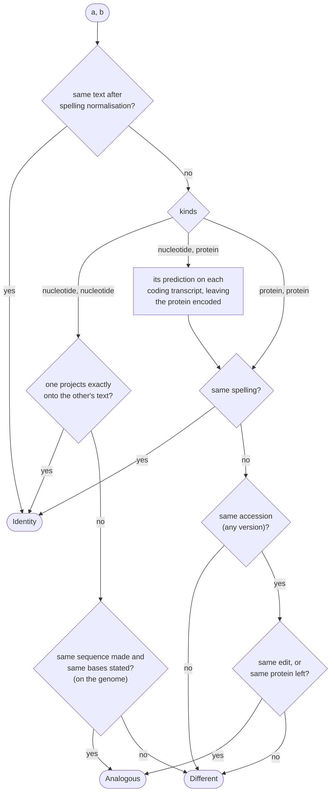

# How Equivalence Is Decided

`VariantMapper.equivalent_level(a, b, searcher)` says whether two HGVS descriptions name the same change. It answers at
one of four levels:

| Level       | Meaning                                                                                                                                                                                                                |
| :---------- | :--------------------------------------------------------------------------------------------------------------------------------------------------------------------------------------------------------------------- |
| `Identity`  | The same text after spelling normalisation; a coding change is so with its prediction. A prediction's parentheses, one-letter codes, a one-member allele's brackets and the order of an allele's members are spelling. |
| `Analogous` | Different text, the same change: the same allele and the same bases stated unchanged, or the same protein left behind.                                                                                                 |
| `Different` | Both descriptions are understood and they name different changes.                                                                                                                                                      |
| `Unknown`   | A description could not be judged (an error from the data provider, a missing sequence).                                                                                                                               |

`equivalent(a, b, searcher)` is `Identity` or `Analogous`.

## Before comparing

- A gene symbol in place of an accession is expanded to every accession the provider maps it to, of the kind the
  coordinate system needs; the pair is equivalent if any expansion is.
- An `m.` variant is compared as the `g.` variant it is on the mitochondrial reference.
- An `r.` variant is compared as its `c.` or `n.` spelling (`r_to_c`, `r_to_n`); `r.0`, `r.spl` and the other statements
  about a transcript are compared as text.

## The rules

### Nucleotide against nucleotide

Two `g.`, `c.` or `n.` descriptions are the same change when they make the same sequence on the genome and state the
same bases unchanged there. For two single variants that change the sequence that is exactly when their **canonical
alleles** are equal. Bases are stated by identity members and by members that cancel each other, beside a change or
alone, so `c.[7C>T;10_12=]` is not `c.7C>T`, and `c.10=` is not `c.20=`. A canonical allele is the change projected onto
the genomic reference, trimmed to what it alters, then widened over the whole region in which it could equally be
written (VRS/VOCA "fully justified" normalisation). So `c.4_6del` and `c.10_12del` in a run of the same trinucleotide,
`g.10_11insA` and `g.10dup` after an `A`, and a `c.` variant against its own `g.` projection all have one allele. A copy
number has no allele, and written alone is compared by its projection to the genome; as members of a cis allele, copy
numbers and conversions are compared by their projections too, beside the sequence the other members make
([the choice](choices.md#a-cis-allele-is-the-sequence-its-members-make)). A conversion alone is `Different` unless the
text matches.

A cis allele `c.[a;b]` is compared by the sequence its members make, each member projected to the genome and applied
there, so `c.[7C>T;8T>G]` is `c.7_8delinsTG`, whatever the order of the members and however the change is split between
them. Where the provider has no genome, the transcript is used only if nothing the comparison reads reaches outside the
exons or crosses a junction or gap; otherwise the comparison is an error (`Unknown` or `ERR:` in the harness).
[The choice](choices.md#a-cis-allele-is-the-sequence-its-members-make) has the reasoning and the members that cannot be
applied. An allele whose members are
[contradictory or ambiguous](choices.md#overlapping-members-of-a-cis-allele-need-one-reading) is not compared: the
judgement is that error. A one-member allele is its member, and its brackets are spelling, as a prediction's parentheses
are: `c.[7C>T]` and `c.7C>T` are `Identity`. The order of the members is spelling too: `c.[13T>G;7C>T]` and
`c.[7C>T;13T>G]` are `Identity`, and so is a transcript allele with the genomic allele its members project to exactly.
An allele with a member at an uncertain position, or a statement among several members, makes no one sequence; it is
compared member by member ([below](#the-protein-a-description-leaves)), and protein alleles are compared member by
member too.

### Nucleotide against protein

The nucleotide variant is taken to every coding transcript it lies on (a `c.` is its own; a `g.` or `n.` is projected
and the `searcher` names the transcripts), and on each its predicted `p.` description is compared with the given one by
the rule for two protein descriptions ([below](#protein-against-protein)). So a coding change is Identity with its
prediction in any spelling (`c.1799T>A` against `p.(Val600Glu)`, `p.Val600Glu` or `p.V600E`), and otherwise Analogous
when the two can leave the same protein. The pair is as equivalent as the best transcript makes it; a transcript whose
prediction fails makes the pair an error only when no transcript makes it equivalent, and a description that does not
read on its protein is an error whatever the transcripts predict.

The prediction stands for the change, with one difference: the protein it leaves is the one the edited transcript
encodes (`predicted_protein`), not the one its description leaves. A description leaves residues unnamed — a
frameshift's after its first, an extension's tail, a read-through that runs off the transcript — and those match any
residue; the encoded protein has them, and only a description that names the residues that are there matches it. A
coding change is therefore at least as equivalent to a description as its prediction is, except against a description
naming residues the prediction does not, where the encoded protein can disagree. The protein is read as its record
writes it: the annotated first codon as Met whatever it is, a `CTG` start included, and a selenocysteine as `U`
([the choice](choices.md#the-protein-is-read-as-its-record-writes-it)). A frameshift written without its length,
`p.Leu299fs`, matches the encoded protein when that begins with it.

Where the prediction names no sequence, the coding change is compared as the statement it predicts. A start loss,
`p.(Met1?)`, says the change starts at Met1, so it matches `p.Met1fs` and not `p.Leu5fs`. A change predicted to leave
the protein as it is, `c.9G>A` silent in codon 3 or `c.*3G>A` in the 3'UTR, is compared as `p.(Leu3=)` or `p.(=)`. An
identity that covers no whole codon, `c.1114=`, makes no statement about the protein, so it is `Different` from every
protein description. An identity read outward, at every residue whose codon it touches, as ClinVar writes it, claims
residues the identity does not state, so it is `Different` too
([the choice](choices.md#judged-by-allele-and-by-the-protein-left-behind)).

### Protein against protein

Two `p.` descriptions must be on the same protein accession, any version (ClinVar often names an older `NP_` version).
They are `Identity` as one spelling, and `Analogous` on two versions of the accession as one spelling, or when the
proteins they leave can be the same.

### The protein a description leaves

Every `p.` description that says something about the sequence is turned into the protein it leaves, in one-letter code,
read against the reference protein:

- a substitution, deletion, insertion, duplication, delins, repeat or identity is applied to the reference; a **stop**
  among the new residues ends the protein there (`p.Tyr165Ter`, `p.Ala164_Tyr165insTer` and `p.Tyr164_Tyr165delinsTer`
  all leave the protein ended after 164);
- a frameshift `p.Arg97ProfsTer4` leaves the reference up to 96, then `P`, then two residues it does not name (written
  `X`, which matches any residue), then ends;
- a frameshift or extension **without a length** (`p.Arg97fs`, `p.Ter599TrpextTer?`) and a stop loss written as a
  substitution (`p.Ter599Trp`, ClinVar's form) leave an **open** outcome: what is known, then more residues in unknown
  number. An open outcome matches any outcome it is a prefix of;
- `p.0` and `p.0?` leave no protein;
- a description that leaves the protein as it is, `p.(Leu3=)` or `p.Leu3Leu`, is a statement about the residues it
  names, and is the same only as a statement about exactly those residues: `p.(Leu3_Ala4=)` is not `p.(Leu3=)`, and
  `p.=`, about the whole protein, is neither, but is the same as every residue through the stop, `p.Met1_Ter7=`; two
  statements that overlap without naming the same residues are Different
  ([the choice](choices.md#judged-by-allele-and-by-the-protein-left-behind));
- `p.?` (and `p.(?)`) says nothing and matches nothing; `p.Met1?` and its like are **anchored**: they say only where the
  change starts, and match an outcome whose change starts at that residue.

Parentheses that mark a prediction are spelling, since a prediction is taken as its confirmation: `p.(Val600Glu)` is
`p.Val600Glu`, and `r.(=)` is `r.=`. No other parentheses are. Those of `r.(?)` mark no prediction but a statement of
its own: the RNA follows the DNA change it accompanies, which is not `r.?`'s effect of unknown kind, so it is the same
only as itself, also inside a cis allele. Those of an uncertain position, `g.(3_4)del` or `p.(Lys2_Leu3)del`, say the
change is not known exactly; such a description names no one change, so it has no allele and is the same only as itself
([the choice](choices.md#an-uncertain-position-names-no-one-change)). As the member of a cis allele it matches a member
spelled as it is, and the exact members beside it are compared by their alleles, so `g.[(3_4)del;10_11insA]` is
`g.[(3_4)del;10dup]` where g.10 is an A.

Judging needs the protein sequence. With no sequence to read the description against the result is an error (`Unknown`
or `ERR:` in the harness), not a guess from the residues the descriptions happen to name.

## Examples

| Level       | A                                 | B                                    | Why                                                       |
| :---------- | :-------------------------------- | :----------------------------------- | :-------------------------------------------------------- |
| `Identity`  | `c.123A>G`                        | `c.123A>G`                           | Same text.                                                |
| `Identity`  | `NC_…:g.5000A>G`                  | `NM_…:c.123A>G`                      | The `c.` projects to exactly that `g.`.                   |
| `Identity`  | `c.1799T>A`                       | `p.(Val600Glu)`                      | The prediction, written as predicted.                     |
| `Identity`  | `c.1799T>A`                       | `p.Val600Glu`                        | The prediction, confirmed.                                |
| `Analogous` | `c.4_6del`                        | `c.10_12del`                         | One allele: the same trinucleotide run, one unit shorter. |
| `Analogous` | `g.10_11insA`                     | `g.10dup`                            | One allele.                                               |
| `Analogous` | `NM_X.1:c.10_12copy3`             | `NR_XR.1:n.24_26copy3`               | Both project to `g.25_27copy3`.                           |
| `Analogous` | `p.Tyr165Ter`                     | `p.Ala164_Tyr165insTer`              | Both leave the protein ended after 164.                   |
| `Analogous` | `c.495_498del`                    | `p.Ala164_Tyr165insTer`              | The frameshift's first stop is at 165; same protein left. |
| `Analogous` | `c.567delG`                       | `p.Ala190Profs`                      | The frameshift starts Ala190Pro; the rest is unknown.     |
| `Analogous` | `c.-3_4del` (weaver `p.(Met1?)`)  | `p.Met1fs`                           | Both start the change at Met1.                            |
| `Analogous` | `c.1796A>G`                       | `p.Ter599Trp`                        | A stop loss, written as ClinVar writes it.                |
| `Analogous` | `p.490PRS[1]`                     | `p.Pro493_Ser495del`                 | One copy of a three-residue unit removed, either way.     |
| `Different` | `c.123A>G`                        | `c.123A>T`                           | Different alleles.                                        |
| `Different` | `c.1799T>A`                       | `p.Val600Lys`                        | Different protein left.                                   |
| `Different` | `p.(Leu3=)`                       | `p.(=)`                              | One residue unchanged is not the whole protein.           |
| `Different` | `p.Arg97ProfsTer4`                | `p.Arg97_Arg97delinsProAlaValLeuTer` | One residue longer before the stop.                       |
| `Different` | `c.-3_13dup` (weaver `p.(Met1?)`) | `p.Leu5fs`                           | A statement of not knowing does not match a commitment.   |
| `Unknown`   | `c.123A>G`                        | `p.Val41Gly`                         | The provider has no sequence for the protein.             |

Code: [hgvs-weaver/src/equivalence.rs](../../hgvs-weaver/src/equivalence.rs).
